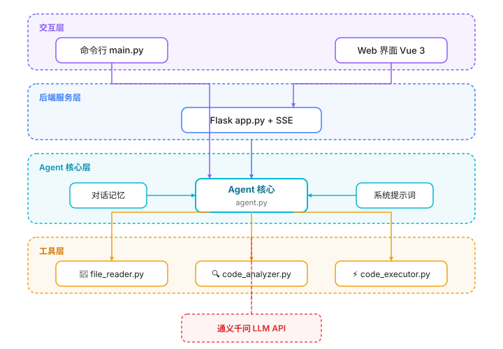
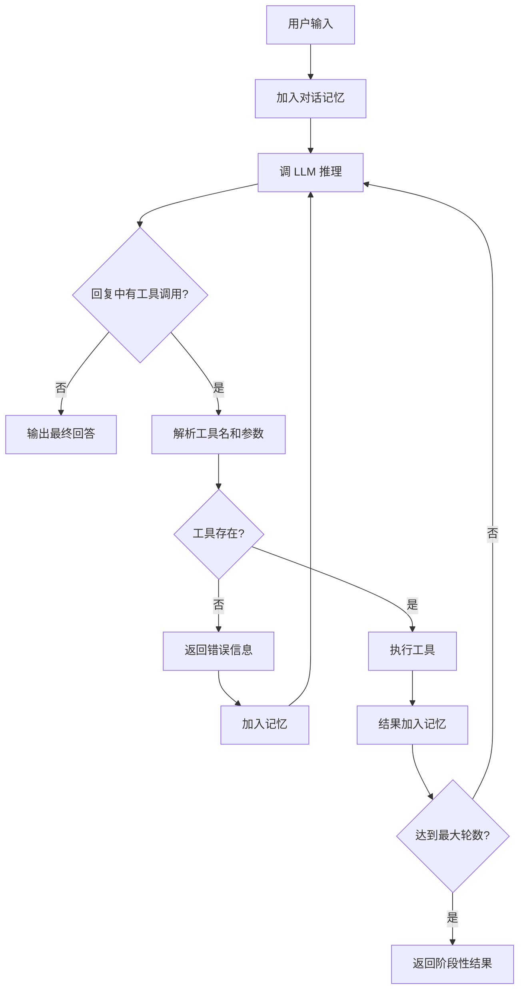

# 设计文档

## 1. 项目概述

基于 LLM 的代码审查 Agent。用户上传文件或粘贴代码，Agent 自主调用工具进行静态分析和深度审查，输出结构化审查报告。

核心目标：**让 LLM 不只是聊天，而是能主动使用工具完成任务。**

---

## 2. 系统架构



### 模块职责

| 模块 | 职责 |
|------|------|
| `main.py` | 命令行入口 |
| `app.py` | Flask 后端 + SSE 流式接口 |
| `agent.py` | Agent 核心循环（推理 → 工具调用 → 再推理） |
| `memory.py` | 对话历史管理，超长截断 |
| `prompts.py` | 系统提示词（角色 + 工具说明） |
| `tools/file_reader.py` | 读取代码文件 |
| `tools/code_analyzer.py` | 静态分析（敏感信息检测 + 函数列表） |
| `tools/code_executor.py` | 沙箱执行代码 |

---

## 3. Agent 工作流

### 核心循环



循环说明：**推理 → 行动 → 再推理**。LLM 决定要不要用工具，用了就把结果喂回去，LLM 继续分析，直到不再调工具给出最终回答。最多 5 轮，防止死循环。

### 工具调用协议

```
[CALL:工具名|参数1=值1|参数2=值2]
```

用正则解析，提取工具名和参数字符串。文本格式的好处是调试时直接能看到 LLM 想干什么。

---

## 4. 关键设计决策

### 4.1 原生 API vs 框架

选原生 API，不选 LangChain。原因：Agent 循环逻辑全部自己写，每一步都看得见。框架把核心封装了，不利于理解 Agent 到底怎么工作的。

### 4.2 工具找事实，LLM 下判断

| 工具 | 定位 |
|------|------|
| read_file | 获取代码内容 |
| analyze_code | 提取确定性事实（行数、敏感信息、函数列表） |
| execute_code | 验证手段，跑一下看结果 |

工具给出确定的信息，LLM 基于这些信息做语义分析和综合判断。两者互补。

### 4.3 工具失败不终止

工具执行出错（文件不存在、参数错误）不抛异常退出，而是把错误信息返回给 LLM。LLM 看到错误可以调整策略再试。工具失败对 Agent 来说是正常输入，不是程序异常。

### 4.4 代码执行安全

- **子进程隔离** — 写到临时文件，subprocess 执行
- **超时控制** — 最多 5 秒，防止死循环
- **危险操作拦截** — `os.system`、`os.remove` 等直接拒绝
- **自动清理** — 执行完删临时文件

原则：不能信任要执行的代码，必须做好隔离。

---

## 5. Web 端

左右分栏布局，新野兽派风格。左侧拖拽上传 + 代码粘贴，右侧实时显示审查报告（统计卡片 + 问题列表 + 改进建议）。

SSE 流式推送，前端实时接收静态分析结果和 LLM 审查进度。

---

## 6. 限制与改进

| 限制 | 说明 |
|------|------|
| 单会话 | Web 端只有一个全局 Agent 实例 |
| 解析脆弱 | 文本格式靠正则，LLM 写错格式会失败 |
| 审查质量依赖 LLM | 工具只提供事实，判断靠模型能力 |
| 仅 Python 深度分析 | 函数列表提取用 Python AST |

可改进方向：多会话支持、Function Calling、多语言 AST、批量审查。
